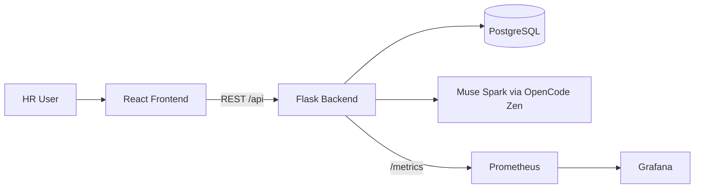

# AI Job Screener — DevOps

## Secrets (never commit real values)

```bash
kubectl apply -f k8s/namespace.yaml
kubectl -n job-screener create secret generic app-secrets \
  --from-literal=postgres-password=CHANGE_ME \
  --from-literal=muse-spark-key=CHANGE_ME \
  --from-literal=muse-spark-base-url=https://opencode.ai/zen/go/v1
kubectl apply -n job-screener -R -f k8s/
```

Apply order: namespace → secret → configmap → postgres → backend → frontend → ingress.

## Minikube

```bash
minikube start --driver=docker
minikube addons enable ingress
# add "$(minikube ip) screener.local" to hosts
```

Verify: `kubectl -n job-screener rollout status deploy/backend`, then
`bash scripts/smoke.sh http://$(minikube ip)` (or port-forward
`svc/backend 5000:5000` and use `http://localhost:5000`).

## Jenkins credentials

| ID | Type |
| -- | ---- |
| `docker-hub-creds` | username/password |
| `kube-config` | kubeconfig file |
| `muse-spark-key` | secret text |
| `dockerhub-user` / `muse-spark-base-url` | env/credential per Jenkinsfile |

Pipeline stages: Checkout → Lint → Unit Tests → Docker Build → Push →
Deploy K8s → Health/API Test.

## Monitoring

```bash
kubectl apply -n job-screener -f monitoring/prometheus.yaml
curl backend:5000/metrics | grep screening_requests_total
```

Import `monitoring/grafana-dashboard.json` into Grafana (panels: request
rate, AI failures, p95 latency; average score via `GET /api/analytics/overview`).

## Architecture


